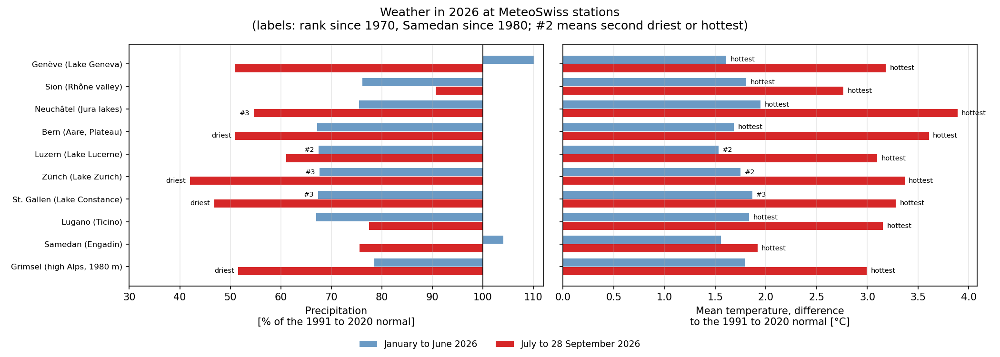
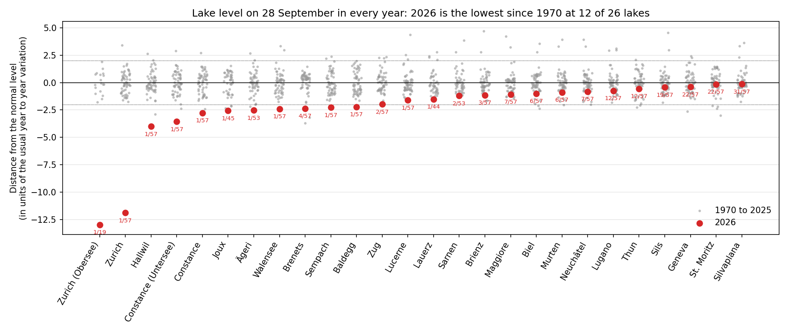
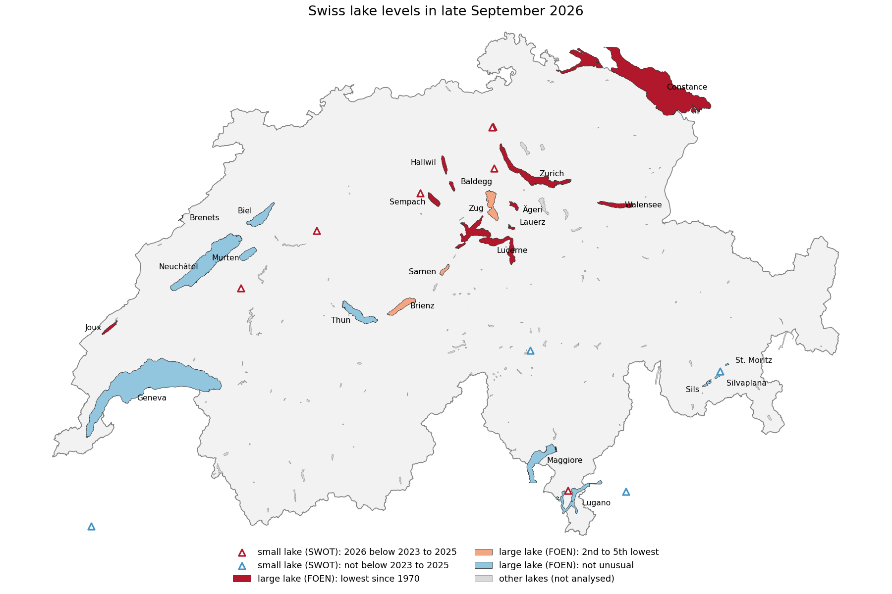
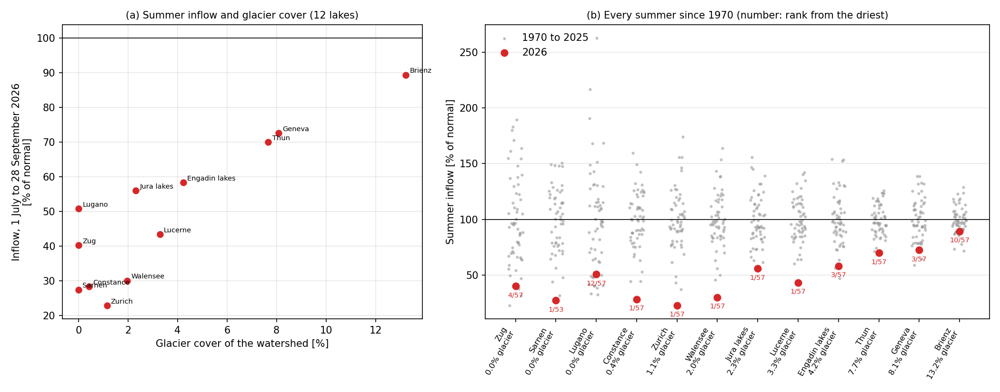
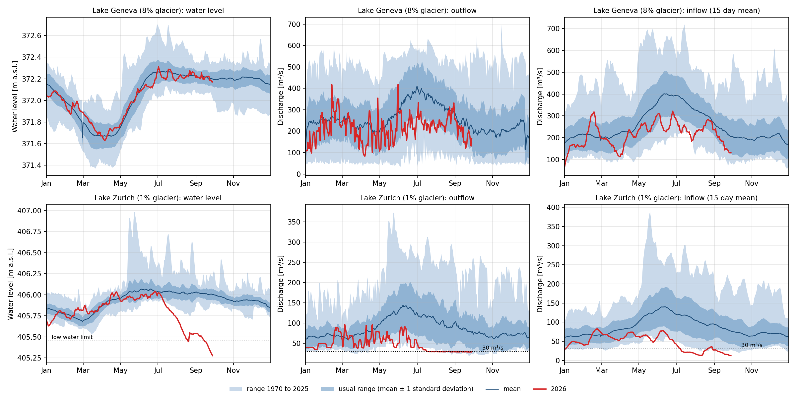
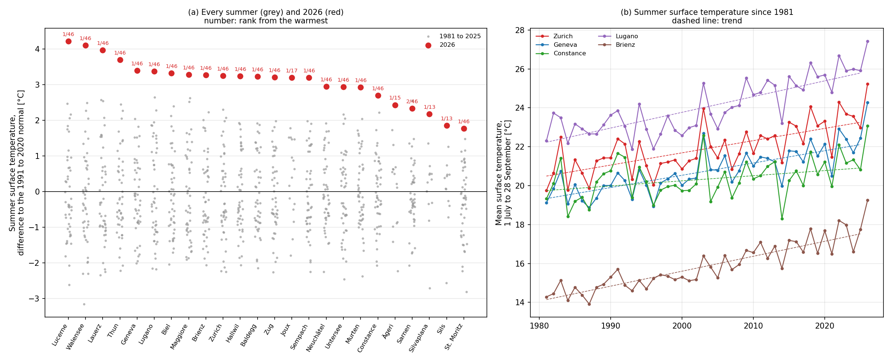
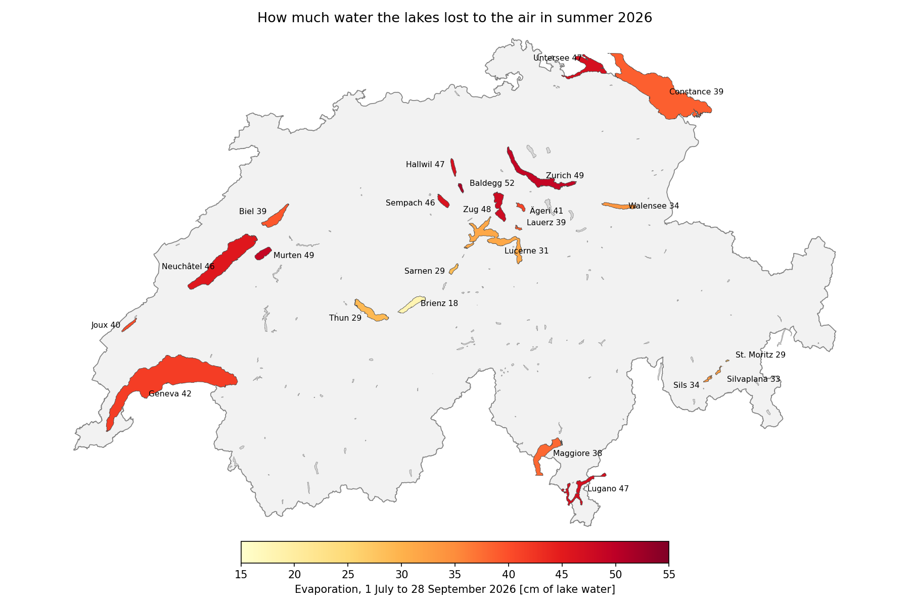
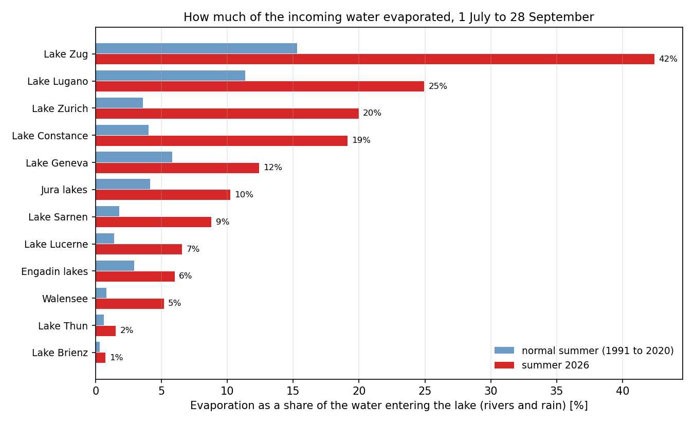
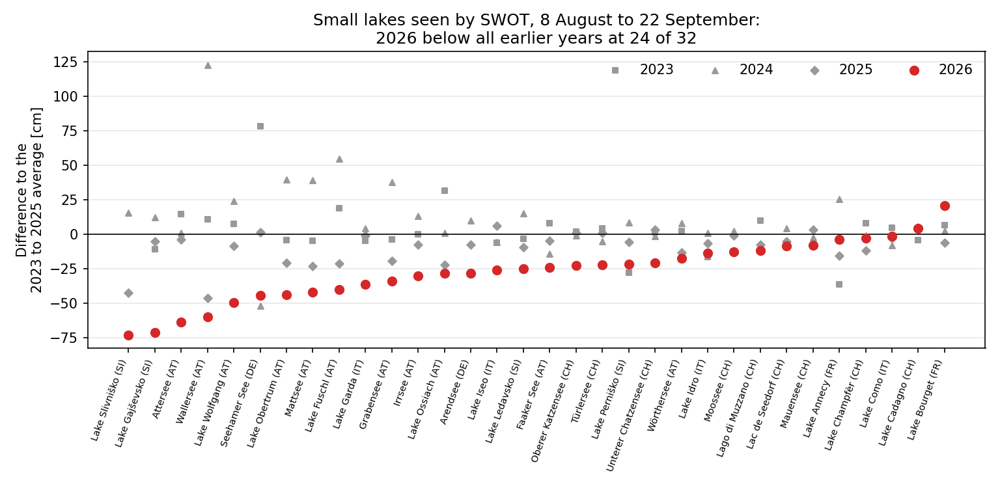
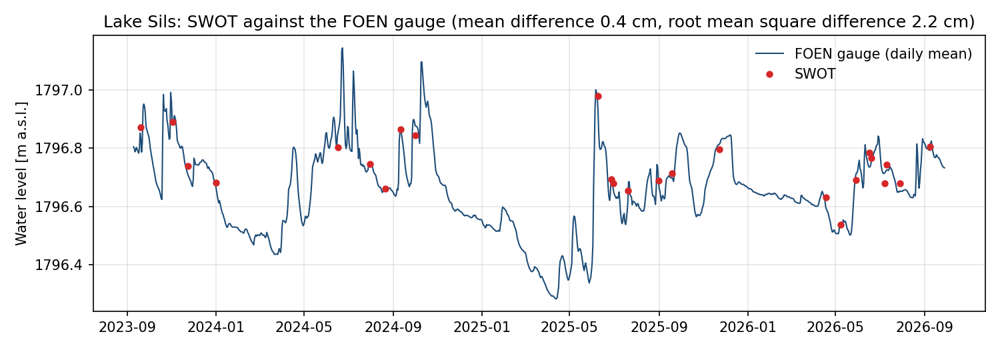

## If you have only 20 seconds

* 12 of the 26 large Swiss lakes are at their lowest late September water level since 1970, after the hottest summer on record and very little rain on the Plateau.
* The lakes of the Plateau, the Prealps and the Jura suffered most. Lake Geneva, Lake Thun and Lake Brienz are almost at their usual level.
* Glaciers can explain a large part of the difference: Lake Brienz still received about 90% of its usual summer inflow, Lake Zurich less than a quarter.
* Lake Geneva looks normal because its outflow was reduced to match the smaller inflow. Lake Zurich reached the point where this was no longer possible, and its level fell below the official low water limit.
* The lakes also had their warmest summer since at least 1981, about 3 °C above normal, and evaporated much more water than usual.

## A hot and dry summer

Summer 2026 was exceptional (Figure 1). At all ten MeteoSwiss stations analysed here, from Geneva to the Engadin, July to September was the hottest since 1970, around 3 °C above the 1991 to 2020 climate normal and close to 4 °C in Neuchâtel.  Zurich received only 42% of its normal summer rainfall, St. Gallen 47% and Bern 51%, the lowest values since 1970 at all three.

The dry spell did not start in July. From January to June, the Plateau already had only about two thirds of its normal precipitation, whereas Geneva and the Engadin had a normal first half of the year. Some lakes therefore entered the summer with a deficit, which then grew over the summer.

*Figure 1. Precipitation (left) and temperature (right) at ten MeteoSwiss stations, for January to June (blue) and July to 28 September (red) 2026, compared with the 1991 to 2020 climate normal. Labels give the rank since 1970.*

## Lake levels at record lows

*Figure 2. Lake level on 28 September in every year since 1970 (grey) and in 2026 (red). The number below each red dot is the 2026 rank: 1/57 means the lowest of 57 years.*

Each column in Figure 2 is a Swiss lake. The grey dots show its water level on 28 September for every year since 1970, and the red dot is 2026. The vertical axis measures how far a lake is from its normal level, relative to how much it usually varies from one year to the next. A value of minus 2 is reached roughly once every 40 years, and minus 3 perhaps once in several centuries. Lake Zurich sits at minus 12 which is a clear extreme. For the lakes to the right of Lake Maggiore, the difference from normal is small.

For 12 of the 26 lakes, including Lake Zurich, Lake Constance and Lake Hallwil, 2026 is the lowest late September level since 1970. At most of them the previous record goes back to the heatwave summer of 2003. The lower basin of Lake Constance (Untersee) is now 39 cm below its 2003 level. Lake Zurich is 62 cm below its previous record low, which was in 2009.

The spatial variability is clearly visible on a map. The record lows (dark red in Figure 3) are all on the Plateau, in the Prealps and in the Jura: Lake Zurich, Lake Constance, Walensee, Lake Sempach, Lake Hallwil, Lake Baldegg, Ägerisee and Lac de Joux, with Lake Zug just behind. Lakes fed from the high Alps are much closer to normal. That includes Lake Geneva, Lake Thun, Lake Brienz and the lakes of the Engadin. Ticino lies in between.

*Figure 3. Large lakes with a FOEN gauge, coloured by how the late September 2026 level ranks since 1970, and small natural lakes seen by the SWOT satellite (triangles), coloured by whether 2026 is below 2023, 2024 and 2025. Lakes in grey were not analysed.*

## Why some lakes suffer more

At first sight, two main reasons can explain the difference. One is glaciers. The other is how the lakes are regulated.

### Glaciers

During a hot and dry summer, rivers fed by rain dry up, while rivers fed by glaciers keep flowing. The water that actually entered each lake between July and September can be reconstructed from the measured outflow and the change in lake level, and compared with the share of the watershed covered by glaciers (Figure 4).

*Figure 4. Left: summer inflow in 2026, as a percentage of the 1970 to 2025 average, against the glacier cover of the watershed. Right: summer inflow in every year since 1970 (grey) and in 2026 (red), lakes ordered by glacier cover.*

The relationship between glacier cover and the summer inflow is very clear. Lake Brienz, whose watershed is about 13% glacier, still received 89% of its normal summer inflow. Lake Geneva and Lake Thun, with about 8% glacier, got 73% and 70%. At the other end, Lake Constance and Lake Zurich (1% or less) received only 28% and 23%. For 7 of the 12 lake systems analysed, this was the driest summer since 1970.

Note that watersheds with glaciers are also the highest ones, where snow melts late in the season, so the effect of the glaciers cannot be fully separated from the effect of altitude.

### Regulation

Most large Swiss lakes have a weir at their outlet. In a normal year, the level of Lake Zurich moves by only a few centimetres, because the outflow is adjusted day by day. The difference between Lake Geneva and Lake Zurich is particularly interesting (Figure 5).

*Figure 5. Lake Geneva (top) and Lake Zurich (bottom) in 2026 (red) compared with 1970 to 2025 (blue): water level, outflow and reconstructed inflow. Dotted lines: low water limit of Lake Zurich (405.45 m) and the outflow of 30 m³/s held into the Limmat.*

Lake Geneva's inflow was well below normal this summer, the third lowest since 1970. Yet, thanks to the glaciers, it never dropped below about 130 m³/s. The operators in Geneva (city) released less water, and the lake level stayed close to normal. The shortage was passed on to the Rhône downstream.

The situation for Lake Zurich was drastically different. On 1 July its level was still normal. From the middle of July, the outflow into the Limmat was held at about 30 m³/s, the flow normally kept in the river. The inflow, however, kept falling, and by August and September it was only 15 to 30 m³/s, below what the lake was releasing. From that point, regulation could no longer hold the water level, which dropped by about 70 cm in two months. On 28 September, Lake Zurich stood at 405.28 m, 17 cm below its official low water limit of 405.45 m (BAFU, 2014). On 30 September, at the request of the Canton of Zurich, the federal authorities decided to reduce the outflow to 20 m³/s until the end of October to slow down the decline (Blue News, 2026).

This is also why Lake Zurich looks so extreme in Figure 2. The lake normally barely moves, so a drop that would be quite ordinary for Lake Maggiore is completely off the scale here.

## A record warm summer for the lakes

### Surface temperature

The Simstrat lake model, run every day for more than 100 lakes on Alplakes, reconstructs the temperature of each lake back to 1981. Between 1 July and 28 September 2026, the surface water (1 m depth) was the warmest in this record at 23 of the 24 lakes analysed, typically 3 °C above the 1991 to 2020 normal and up to 4 °C in Lake Lucerne and Walensee (Figure 6). Only Lake Sarnen had a warmer summer, in 2003. Lake Zurich averaged 25.2 °C, Lake Geneva 24.3 °C and Lake Lugano 27.4 °C.

*Figure 6. Left: summer (1 July to 28 September) surface temperature of each lake in every year since 1981 (grey) and in 2026 (red), as a difference to the 1991 to 2020 normal; the number gives the 2026 rank from the warmest. Right: summer surface temperature since 1981 for five lakes, with the long term trend (dashed). Values from the Simstrat model on Alplakes.*

The previous records, mostly from 2022, 2018 and 2003, were beaten by about one degree. Interestingly, the warmest single days were not exceptional: the daily maximum only set a new record on 10 of the 24 lakes, and then by a few tenths of a degree. What made 2026 special was, in the end, the length of the warm period. The summer also sits on top of a clear long term warming (Figure 6, right) as already shown in the in situ monitoring of 21 large Swiss lakes, where mean annual surface temperatures ([Bärenbold et al., 2026](https://doi.org/10.5194/essd-18-6527-2026)).

### Evaporation

A hot summer comes with increased evaporation. Warm water evaporates faster: combined with air temperature, humidity and wind from nearby MeteoSwiss stations, the Simstrat surface temperature gives an estimate of the water lost to the air (Figure 7).

*Figure 7. Water evaporated from each lake between 1 July and 28 September 2026, in cm of lake level, estimated from the Simstrat surface temperature and MeteoSwiss data. Lakes in grey were not analysed.*

Between 1 July and 28 September, evaporation removed between 18 cm (Lake Brienz) and 52 cm (Lake Baldegg) of water from the lake surfaces. That is 5 to 19 cm more than in a normal summer, and the highest value since 1991 for 20 of the 24 lakes. Lake Brienz, Lake Thun and the lakes of the Engadin, fed by cold glacier water, stayed cooler and lost the least.

*Figure 8. Evaporation as a share of the water entering the lake from rivers and rain, in a normal summer (blue) and in 2026 (red), for the lake systems with a reconstructed inflow.*

In a normal summer, evaporation is a minor term in the water budget of the large lakes. In 2026, Lake Zurich and Lake Constance lost roughly a fifth of their incoming water to the air, against about 4% in a normal summer, and Lake Zug about 40% (Figure 8). These shares depend on the absolute evaporation, which is uncertain by about 30%, so they should be read as orders of magnitude. For Lake Zurich, evaporation removed about 49 cm of water over the summer, 17 cm more than usual. With the outflow already at its minimum, the rivers could no longer make up for it.

## Small lakes seen from space

It is also important to follow small lakes and reservoirs. Yet, most of them have no gauge at all. Since 2023 the SWOT satellite has been measuring their water level every few weeks. Compared with the FOEN gauge on Lake Sils, the satellite agrees within about 2 cm (Figure 10, in the Methods). For small lakes, 2026 can only be compared with 2023, 2024 and 2025, but they show the same pattern as the large lakes (Figure 9). Between 8 August and 22 September, 2026 was lower than all three previous years at 24 of the 32 natural lakes. 

*Figure 9. Small lakes seen by SWOT: how far the level was from the 2023 to 2025 average between 8 August and 22 September, in 2026 (red) and in each earlier year (grey).*

## Data

The water levels and river flows come from the Federal Office for the Environment (FOEN, [data.bafu.admin.ch](https://data.bafu.admin.ch/en/)), which provides daily values for 26 lakes and for the rivers leaving them, back to 1970. Precipitation and temperature come from the MeteoSwiss open data. The description of the watersheds (their size, their altitude and how much of them is covered by glaciers) comes from the CAMELS-CH database (Höge et al., 2023). Lake surface temperatures come from the Simstrat model run operationally by [Alplakes](https://www.alplakes.eawag.ch). For small lakes without any gauge, water levels measured by the SWOT satellite were collected through Alplakes.

For each lake, the current year's level is compared with the level on the same day in every year since 1970. Only a few lakes are shown here; plots for all of them, the code and the data are in the Git repository ([github.com/damienbouffard/WaterLevel](https://github.com/damienbouffard/WaterLevel)). The code was written with the help of AI. All 2026 values are provisional and may still be revised by the data providers.

## Methods

### Water level climatology

For each FOEN lake gauge, the daily mean levels from 1970 to 2025 give, for every calendar day, a mean, a standard deviation, a minimum and a maximum. This year's level is compared with the same calendar day. The value on the vertical axis of Figure 2 is (level minus mean) divided by the standard deviation for that day. The return periods quoted in the text assume a bell shaped distribution, which is only roughly true for lake levels; the rank shown in Figure 2 does not depend on this assumption.

### Weather

For ten MeteoSwiss stations, daily precipitation totals and daily mean temperatures were summed or averaged over 1 January to 30 June and over 1 July to 28 September, in every year since 1970. 2026 is compared with the 1991 to 2020 climate normal, the reference period used by MeteoSwiss, and ranked against all years since 1970.

### Inflow

For 12 lake systems with a FOEN discharge gauge at the outlet, the inflow is reconstructed from the water balance: inflow equals outflow plus lake area times the rate of change of the level. This does not depend on how the lake is regulated. It is the net inflow, after evaporation from the lake surface. Connected lakes are treated together (the three Jura lakes, and the Upper Engadin lakes), the Sihl is subtracted from the Limmat for Lake Zurich, and the lake areas come from the FOEN lake layer (VECTOR25). Lago Maggiore, Lac de Joux, Hallwilersee, Baldeggersee, Ägerisee and Lauerzersee have no FOEN gauge at the outlet and could not be included. Lake Sempach was left out: its summer net inflow is close to zero, so percentages of it are not meaningful.

### Surface temperature

The surface temperature is the daily mean Simstrat temperature at 1 m depth from the Alplakes API, averaged over 1 July to 28 September of every year since 1981 (since 2010 to 2014 for Lac de Joux, Ägerisee, Lej da Segl and Lej da Silvaplauna, whose Simstrat runs start later). Anomalies are relative to 1991 to 2020, or to the available years for the shorter runs. The trend is a linear fit over 1981 to 2025.

### Evaporation

Evaporation is computed with the bulk formula used in Simstrat for the latent heat flux (Livingstone and Imboden, 1989). The heat lost by evaporation, $Q_e$ (W m$^{-2}$), is

$$Q_e = f(U)\,\left[e_s(T_w)\,c(p) - e_a\right], \qquad f(U) = 4.4 + 1.82\,U + 0.26\,(T_w - T_a)$$

where $f(U)$ is the wind function (W m$^{-2}$ hPa$^{-1}$, set to zero if negative), $U$ the wind speed at 10 m (m s$^{-1}$), $T_w$ the water surface temperature and $T_a$ the air temperature (°C), and $e_a$ the vapour pressure of the air (hPa). The saturation vapour pressure at the water surface follows the Magnus formula, with a small pressure correction (Gill, 1982):

$$e_s(T_w) = 6.112\,\exp\!\left(\frac{17.62\,T_w}{243.12 + T_w}\right), \qquad c(p) = 1.0007 + 3.46\times10^{-6}\,p$$

with $p$ the air pressure (hPa). The evaporation rate $E$ (m s$^{-1}$) is then

$$E = \frac{Q_e}{\rho_w\,L_v}$$

with $\rho_w = 1000$ kg m$^{-3}$ the density of water and $L_v = 2.47\times10^{6}$ J kg$^{-1}$ the latent heat of vaporisation; 1 W m$^{-2}$ corresponds to about 0.035 mm of evaporation per day. $T_w$ is the daily mean Simstrat temperature at 1 m depth from the Alplakes API. $T_a$, $e_a$, $U$ and $p$ are daily means at a nearby MeteoSwiss station, on the lake shore where possible (for instance Pully for Lake Geneva, Wädenswil for Lake Zurich, Güttingen for Lake Constance). The normal is 1991 to 2020, or the available years for lakes with a shorter Simstrat or station record. The heat fluxes computed inside Simstrat are not available through the Alplakes API, hence this offline estimate. Because the wind is measured on land and daily means are used, absolute values carry an uncertainty of roughly 30%; differences between years and between lakes are more robust.

The reconstructed inflow $Q_{in}$ is a net inflow (rivers plus rain on the lake minus evaporation). With the lake area $A$ and the precipitation $P$ measured at the same station, the water brought by the rivers and the share of evaporation in the total water input are

$$R = Q_{in} + (E - P)\,A, \qquad \text{share} = \frac{E\,A}{R + P\,A}$$

### Glaciers

The glacier area and watershed area of each lake gauge come from CAMELS-CH (Höge et al., 2023), which relies on the Swiss Glacier Inventory.

### SWOT

Water levels from the SWOT lake product were collected through Alplakes, converted to the Swiss height system and filtered, keeping only valid points with an uncertainty of 10 cm or less. Over 25 passes on Lake Sils (Figure 10), SWOT agrees with the FOEN gauge with a mean difference of 0.4 cm and a root mean square difference of 2.2 cm. Since the record starts in July 2023, the reference period is 2023 to 2025, and each calendar day pools all observations within 15 days on either side. Lakes whose level varies by more than 2 m were treated as reservoirs.

*Figure 10. Lake Sils (Lej da Segl): water level measured by SWOT (red dots) against the daily mean of the FOEN gauge (blue line), September 2023 to September 2026.*

## References

* FOEN / BAFU hydrological data: [data.bafu.admin.ch](https://data.bafu.admin.ch/en/)
* BAFU (2014). Regulierung Zürichsee. Faktenblätter zur Seeregulierung. Federal Office for the Environment, Bern.
* Blue News (2026). Wegen Trockenheit fliesst weniger Wasser die Limmat hinunter. 30 September 2026. [bluewin.ch](https://www.bluewin.ch/de/news/wegen-trockenheit-fliesst-weniger-wasser-die-limmat-hinunter-li.3619486)
* MeteoSwiss open data, automatic weather stations: [data.geo.admin.ch](https://data.geo.admin.ch/browser/index.html#/collections/ch.meteoschweiz.ogd-smn)
* Höge, M. et al. (2023). CAMELS-CH: hydro meteorological time series and landscape attributes for 331 catchments in hydrologic Switzerland. *Earth System Science Data* 15, pages 5755 to 5784. Data: [doi:10.5281/zenodo.15025258](https://doi.org/10.5281/zenodo.15025258)
* Simstrat lake model, operational runs on Alplakes: [alplakes.eawag.ch](https://www.alplakes.eawag.ch)
* Goudsmit, G.H., Burchard, H., Peeters, F. and Wüest, A. (2002). Application of k epsilon turbulence models to enclosed basins: the role of internal seiches. *Journal of Geophysical Research* 107 (C12), 3230.
* Bärenbold, F., Capelli, C., De Ventura, L., Eyring, S., Folly, E., Gallina, N., Känel, B., Keller, P., Köster, O., Lepori, F., Lovas, R., Rogora, M., Janssen, D.J., Bouffard, D. and Schmid, M. (2026). Long term temperature, oxygen and water clarity trends in Swiss lakes. *Earth System Science Data* 18, pages 6527 to 6544. [doi:10.5194/essd-18-6527-2026](https://doi.org/10.5194/essd-18-6527-2026)
* Gill, A.E. (1982). *Atmosphere Ocean Dynamics*. Academic Press, New York.
* Livingstone, D.M. and Imboden, D.M. (1989). Annual heat balance and equilibrium temperature of Lake Aegeri, Switzerland. *Aquatic Sciences* 51, 351 to 369.
* SWOT (NASA and CNES) lake product, via Alplakes: [alplakes.eawag.ch](https://www.alplakes.eawag.ch)
* Lake outlines and areas: FOEN, VECTOR25 lake layer, via map.geo.admin.ch
* Swiss border: swisstopo, swissBOUNDARIES3D
* Code, data and figures: [github.com/damienbouffard/WaterLevel](https://github.com/damienbouffard/WaterLevel)
* Analysis notebook for levels, weather, map and SWOT: `lake_levels_climatology.ipynb`
* Analysis notebook for outflow, inflow, surface temperature and evaporation:\
  `lake_outflow_inflow_climatology.ipynb`
